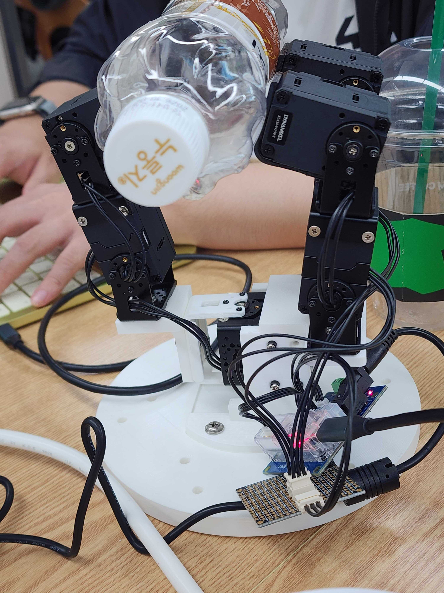
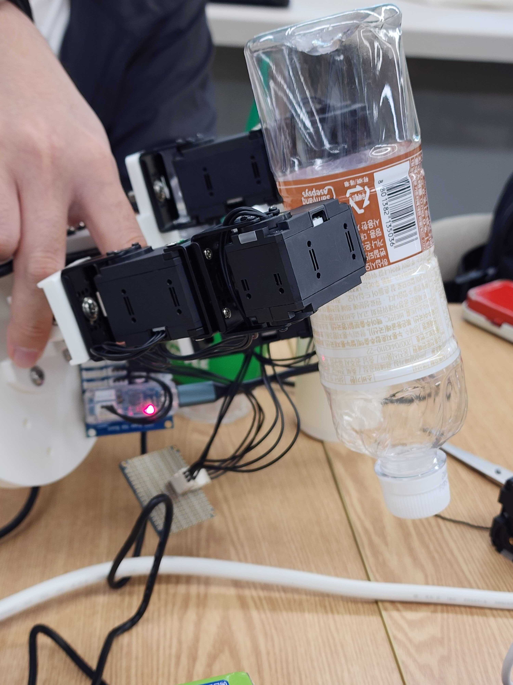
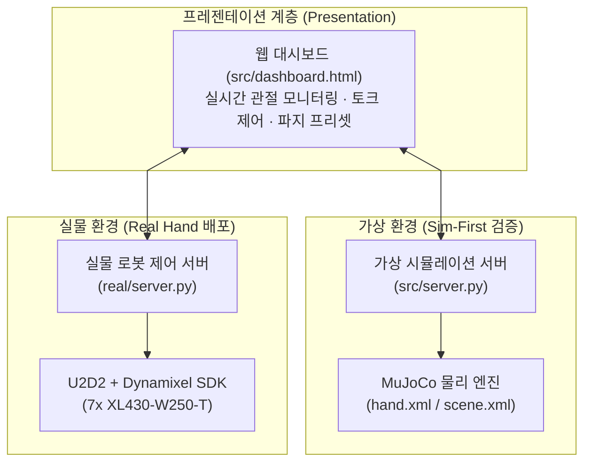
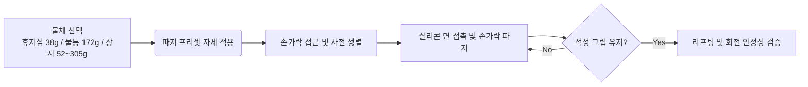
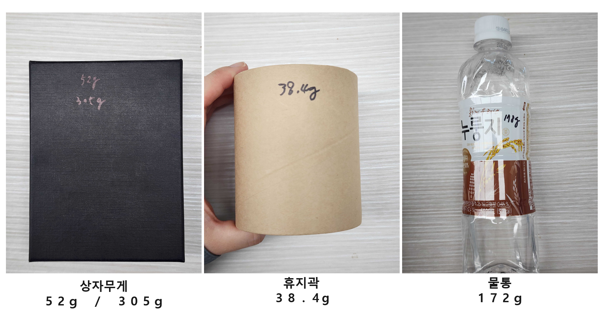

<!-- ========================================== -->
<!-- HERO HEADER                                -->
<!-- ========================================== -->

  <h1 class="nerfies-title">
    3지 다관절 로봇손의 안정적 물체 파지: 기구 설계 및 형상별 파지 검증
  </h1>
  

    tri_hand: 일상 물체(휴지심 38g·물통 172g·상자 52g~305g) 파지를 위한 MuJoCo 가상 검증과 두꺼운 실리콘 면 접촉 설계
  

  

    <a href="https://github.com/yeonjunky" target="_blank">Yeonjun Kim</a>1
    <a href="https://github.com/carryplz" target="_blank">Carryplz</a>1
    <a href="https://github.com/erdoslibrary" target="_blank">Erdoslibrary</a>1
  

  

    1Robot Hand Team / ajin-robot-hand Research Group
  

  

    <a href="https://github.com/ajin-robot-hand/tri_hand" class="nerfies-btn" target="_blank" style="display: inline-flex; align-items: center; gap: 0.5rem; padding: 0.55rem 1.25rem; border-radius: 9999px; background-color: #1e293b; color: #ffffff !important; font-size: 0.92rem; font-weight: 600; text-decoration: none;">
      <svg width="18" height="18" viewBox="0 0 24 24" fill="currentColor"><path d="M12 0C5.37 0 0 5.37 0 12c0 5.31 3.435 9.795 8.205 11.385.6.105.825-.255.825-.57 0-.285-.015-1.23-.015-2.235-3.015.555-3.795-.735-4.035-1.41-.135-.345-.72-1.41-1.23-1.695-.42-.225-1.02-.78-.015-.795.945-.015 1.62.87 1.845 1.23 1.08 1.815 2.805 1.305 3.495.99.105-.78.42-1.305.765-1.605-2.67-.3-5.46-1.335-5.46-5.925 0-1.305.465-2.385 1.23-3.225-.12-.3-.54-1.53.12-3.18 0 0 1.005-.315 3.3 1.23.96-.27 1.98-.405 3-.405s2.04.135 3 .405c2.295-1.56 3.3-1.23 3.3-1.23.66 1.65.24 2.88.12 3.18.765.84 1.23 1.905 1.23 3.225 0 4.605-2.805 5.625-5.475 5.925.435.375.81 1.095.81 2.22 0 1.605-.015 2.895-.015 3.3 0 .315.225.69.825.57A12.02 12.02 0 0024 12c0-6.63-5.37-12-12-12z"/></svg>
      Code (GitHub)
    </a>
  

<!-- ========================================== -->
<!-- TEASER MEDIA: HERO DEMO VIDEO              -->
<!-- ========================================== -->

  

    <iframe 
      src="https://www.youtube.com/embed/c8-295kr47s?rel=0&modestbranding=1" 
      title="tri_hand Real Hardware Robot Hand Demo" 
      style="position: absolute; top: 0; left: 0; width: 100%; height: 100%; border: 0; border-radius: 10px;"
      allow="accelerometer; autoplay; clipboard-write; encrypted-media; gyroscope; picture-in-picture; web-share" 
      referrerpolicy="strict-origin-when-cross-origin" 
      allowfullscreen>
    </iframe>
  

  

    <strong>Teaser: Real Hardware Demonstration:</strong> 3지 7자유도 로봇손이 두꺼운 실리콘 테이프 기반의 면 접촉 마찰력을 통해 물체를 안정적으로 파지하고 제어하는 실물 구동 영상입니다. (<a href="https://youtu.be/c8-295kr47s" target="_blank" style="color: #60a5fa; text-decoration: underline;">YouTube에서 보기</a>)
  

<!-- more -->

<!-- ========================================== -->
<!-- SECTION 1: ABSTRACT & CONTRIBUTIONS        -->
<!-- ========================================== -->

  <h2 class="nerfies-sec-title">Abstract &amp; Key Contributions</h2>
  

      로봇 손의 가장 본질적인 목적은 <strong>다양한 일상 물체를 떨어뜨리지 않고 안정적으로 쥐는 것(Grasping)</strong>입니다.
      본 프로젝트 <code>tri_hand</code>는 3개 손가락과 7개의 독립 관절(7자유도)을 가진 로봇 손을 컴퓨터 가상 환경(MuJoCo)에서 먼저 검증하고, 실제 로봇(Dynamixel XL430-W250-T 7축)에 안전하게 적용하는 가상-실물 연계(Sim-to-Real)를 시도했습니다.
    

      실제 개발에서는 복잡한 이론 역학 유도나 실물 하드웨어에서의 과도한 통제 조건 대신, <strong>가상 시뮬레이션을 통한 사전 기구 검증</strong>과 <strong>하드웨어 접촉면의 실용적 개선</strong>에 집중했습니다. 이를 통해 로봇의 충돌 및 파손 리스크를 사전에 차단하면서도, 일상 물체를 안정적으로 다룰 수 있는 제어 시스템을 구축했습니다.
    

<h4 style="margin: 0 0 0.8rem 0; font-size: 1.05rem; color: var(--md-typeset-color, #1e293b);">🌟 핵심 설계 및 검증 성과</h4>
<ul style="margin-bottom: 0; padding-left: 1.2rem;">
      <li><strong>MuJoCo 시뮬레이션 선행 검증 (Sim-to-Real)</strong>: 실물 로봇을 직접 조작하기 전에 가상 환경에서 손가락 관절의 안전 가동 범위와 충돌 여부를 먼저 시각적으로 확인하고, 동일한 REST API 규격으로 실물 로봇에 안전하게 연결했습니다.</li>
      <li><strong>두꺼운 실리콘 테이프 기반 면 접촉 구현</strong>: 미끄러지기 쉬운 3D 프린팅 손가락 끝 대신 모터(액추에이터) 외곽에 두꺼운 실리콘 테이프를 둘러 마찰력을 대폭 높이고, 모든 대상 물체에 안정적인 면 접촉을 형성했습니다.</li>
      <li><strong>회전 동작을 포함한 실용적 파지 검증</strong>: 엄격한 정적 통제 대신 일상 물체 3종(휴지심 약 38g, 물통 약 172g, 상자 약 52g~305g)을 파지한 뒤, 로봇 손을 공중으로 들어 올려 3차원으로 회전하고 움직여도 떨어지지 않는 것을 실물 검증 기준으로 삼았습니다. (특히 파지에 유리한 높이 2cm 상자는 약 52g부터 약 305g까지 하중을 추가해 한계 안정성을 확인했습니다.)</li>
</ul>

{ style="width: 100%; max-height: 280px; object-fit: contain; border-radius: 10px; border: 1px solid #e2e8f0; box-shadow: 0 4px 12px rgba(0,0,0,0.06); background-color: #f8fafc;" }

  ▲ 평면 물체 파지 (flat)

{ style="width: 100%; max-height: 280px; object-fit: contain; border-radius: 10px; border: 1px solid #e2e8f0; box-shadow: 0 4px 12px rgba(0,0,0,0.06); background-color: #f8fafc;" }

  ▲ 회전 시 파지 유지 (rotation)

  

<!-- ========================================== -->
<!-- QUANTITATIVE RESULTS (Stat Badges)         -->
<!-- ========================================== -->

<h2 class="nerfies-sec-title">Key Benchmark Highlights</h2>

  
38g ~ 305g

  
Payload Range Tested

  
휴지심(38g), 물통(172g), 높이 2cm 상자(52g→305g) 실측 파지 검증

  
3 Objects

  
Benchmark Items

  
휴지심 · 물통 · 상자 대상 실리콘 면 접촉 파지

  
Zero Drop

  
Dynamic Rotation

  
파지 후 로봇 손을 들어 올려 3차원 회전 시에도 무낙하 유지

<!-- ========================================== -->
<!-- SECTION: SIM-TO-REAL SYSTEM ARCHITECTURE   -->
<!-- ========================================== -->

  <h2 class="nerfies-sec-title">Sim-to-Real System Architecture</h2>
  

    시뮬레이션(<code>src/server.py</code>)과 실물 로봇(<code>real/server.py</code>)이 공용 REST API와 웹 대시보드를 공유합니다. 
    가상 환경에서 먼저 검증한 안전 가동 범위와 파지 프리셋을 실물 로봇에 그대로 안전하게 전송합니다.
  

<!-- ========================================== -->
<!-- SECTION 2: GRASPING PIPELINE               -->
<!-- ========================================== -->

  <h2 class="nerfies-sec-title">Grasping Control Pipeline</h2>
  

    물체 형태별 파지 준비 자세부터 목표 파지 및 회전 유지까지의 파이프라인입니다.
  

  Step 1
  
사전 자세 정렬

  
물체 크기에 맞춰 Finger A·B·C의 열림 각도를 결정하고 진입 중심축 정렬

  Step 2
  
실리콘 면 접촉

  
모터 주변의 두꺼운 실리콘 테이프가 물체 표면에 밀착할 때까지 모터를 동시 제어

  Step 3
  
적정 그립 인가

  
물체 찌그러짐 없이 충분한 마찰력을 발휘할 수 있는 알맞은 파지 각도 유지

  Step 4
  
리프팅 &amp; 회전 검증

  
로봇 손을 들어 올리고 3차원으로 회전시켜도 물체가 떨어지지 않는 안정성 확보

<!-- ========================================== -->
<!-- SECTION 3: EXPERIMENTAL OBJECTS            -->
<!-- ========================================== -->

  <h2 class="nerfies-sec-title">3대 대상 물체별 파지 특성 및 실물 검증</h2>
  

모든 물체는 액추에이터 주변에 감은 **두꺼운 실리콘 테이프를 통해 넓은 면 접촉**을 형성하며, 파지 성공 판정은 **"로봇 손을 들어 올려 3차원으로 회전하고 움직여도 물체가 떨어지지 않는가"**를 기준으로 검증했습니다.

{ style="max-width: 100%; max-height: 420px; border-radius: 12px; box-shadow: 0 4px 20px rgba(0,0,0,0.08); border: 1px solid #e2e8f0; object-fit: contain;" }

  ▲ 파지 실험에 사용된 대상 물체 3종 (휴지심 38g, 물통 172g, 상자 52~305g)

#### 1. 휴지심 (약 38g) — 가벼운 중공 원통형 물체
- **접촉 특성**: 약 38g의 매우 가볍고 속이 빈 원통 구조. 두꺼운 실리콘 테이프가 종이 곡면에 밀착하여 넓은 면 접촉 형성.
- **핵심 포인트**: 과도한 힘으로 찌그러뜨리지 않으면서도 미끄러짐을 막을 수 있는 적정 닫힘 각도 설정.
- **검증 결과**: 실리콘 마찰력으로 형태 변형 없이 안정적으로 파지 상태를 유지하며, 손을 들어 회전해도 떨어지지 않음.

#### 2. 물통 (약 172g) — 무게감이 있는 원통형 물체
- **접촉 특성**: 약 172g의 매끄러운 플라스틱 원통 표면을 세 손가락의 실리콘 면이 둘러싸며 균형 있는 면 접촉 형성.
- **핵심 포인트**: 플라스틱 표면의 미끄러짐을 방지하고 물통 무게(약 172g)를 충분히 버텨내는 마찰력 확보.
- **검증 결과**: 물통을 쥔 상태에서 로봇 손을 공중으로 들어 올리고 상하좌우로 회전시켜도 미끄러짐 없이 파지 유지.

#### 3. 상자 (높이 2cm) — 평면 물체 및 하중 한계 테스트
- **접촉 특성**: 평평한 액추에이터 면이 상자 양면과 평행하게 맞닿아 가장 넓은 면적의 면 접촉 형성. 특히 **높이가 2cm인 상자**는 손가락 가동 각도와 실리콘 패드 면적이 잘 맞아 파지에 매우 유리함.
- **핵심 포인트**: 파지가 유리한 기하학적 특성을 활용하여, 기본 무게(약 52g)에 무게를 추가해 **약 305g까지 하중을 늘려가며** 파지 한계를 시험.
- **검증 결과**: 하중을 약 305g까지 늘려도 실리콘 테이프의 면 접촉 마찰력 덕분에 물체를 단단히 잡아주었으며, 손을 들어 3차원으로 회전해도 미끄러짐 없이 안정적으로 파지 성공.

  

<!-- ========================================== -->
<!-- SECTION 4: HARDWARE & SPECS                -->
<!-- ========================================== -->

  <h2 class="nerfies-sec-title">Hardware &amp; System Specifications</h2>
  <table class="nerfies-specs-table">
    <thead>
      <tr>
        <th>구분</th>
        <th>사양</th>
        <th>특징 및 구현 내용</th>
      </tr>
    </thead>
    <tbody>
      <tr>
        <td><strong>손가락 구조</strong></td>
        <td>3-Finger (Finger A: 3-DoF, Finger B·C: 각 2-DoF, 총 7-DoF)</td>
        <td>상단 1개 + 하단 2개 대립형(Opposable) 3차원 파지 구조</td>
      </tr>
      <tr>
        <td><strong>모터 구성</strong></td>
        <td>ROBOTIS Dynamixel XL430-W250-T × 7</td>
        <td>정격 토크 1.4 N·m, Protocol 2.0 통신 지원 스마트 액추에이터</td>
      </tr>
      <tr>
        <td><strong>접촉면 설계</strong></td>
        <td>액추에이터 외곽 + 두꺼운 고마찰 실리콘 테이프</td>
        <td>3D 프린팅 부품의 미끄러짐을 방지하고 모든 물체에 충분한 마찰력의 면 접촉 확보</td>
      </tr>
      <tr>
        <td><strong>통신 인터페이스</strong></td>
        <td>Robotis U2D2 + Dynamixel SDK (GroupSyncWrite)</td>
        <td>단일 패킷으로 7축 모터 동시 명령 전달 및 50 Hz 제어 루프</td>
      </tr>
      <tr>
        <td><strong>제어 환경</strong></td>
        <td>FastAPI 기반 REST API + 웹 대시보드</td>
        <td>가상 시뮬레이션(MuJoCo)과 실물 로봇이 공용 API 규격 공유</td>
      </tr>
      <tr>
        <td><strong>안전 장치</strong></td>
        <td>0 rad 부드러운 Homing 복귀 및 가동 범위 초과 보호</td>
        <td>서버 시작 시 안전한 영점 복귀, 관절 한계 초과 시 HTTP 409 차단 및 50 Hz 고정 데드라인 보호</td>
      </tr>
      <tr>
        <td><strong>계측 및 KPI 평가</strong></td>
        <td>50 Hz 제어 지터, 에러율, 시스템 가용률 로깅</td>
        <td><code>--log logs</code> CSV 계측 로깅 및 24시간 내구 구동 검증 (<a href="https://github.com/ajin-robot-hand/tri_hand/blob/main/docs/evaluation.md" target="_blank" style="color: #2563eb; text-decoration: underline;">docs/evaluation.md</a>)</td>
      </tr>
    </tbody>
  </table>

<!-- ========================================== -->
<!-- SECTION 5: LINK TO EXTENSION PROJECT       -->
<!-- ========================================== -->

  

    <h3 style="margin-top: 0; font-size: 1.25rem; color: var(--md-typeset-color, #1e293b);">
      다음 단계: 기본 파지에서 다중 모달 확장으로
    </h3>
    

      본 기본 파지 프로젝트를 기반으로, 가상 물리 시뮬레이션(MuJoCo), 실시간 웹캠 비전 원격 조작, 그리고 0.2ms 오차의 음악 동기화 안무까지 확장 개발한 최종 쇼케이스 글을 확인해 보세요.
    

    <a href="2026-10-14-tri-hand-extension.md" class="nerfies-btn">
      tri-hand-extension 프로젝트 쇼케이스 보러가기 ➡️
    </a>
  

<!-- ========================================== -->
<!-- SECTION 6: BIBTEX CITATION                 -->
<!-- ========================================== -->

  <h2 class="nerfies-sec-title">BibTeX Citation</h2>
  <pre class="nerfies-bibtex-block"><code>@misc{trihand2026basic,
  author    = {Yeonjun Kim and Carryplz and Erdoslibrary},
  title     = {3지 다관절 로봇손의 안정적 물체 파지(Grasping) 설계 및 실험적 검증},
  year      = {2026},
  publisher = {GitHub},
  howpublished = {\url{https://github.com/ajin-robot-hand/tri_hand}},
  note      = {3-Finger Robotic Grasping Mechanism and Empirical Characterization}
}</code></pre>

