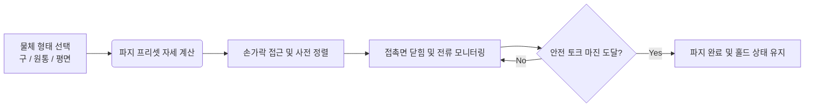

<!-- ========================================== -->
<!-- HERO HEADER                                -->
<!-- ========================================== -->

  <h1 class="nerfies-title">
    3지 다관절 로봇손의 안정적 물체 파지: 기구 설계 및 형상별 파지 검증
  </h1>
  

    tri_hand: 200g 미만 구·원통·평면 물체의 안정적 파지를 위한 접촉면 설계와 경험적 검증(Empirical Characterization)
  

  

    <a href="https://github.com/yeonjunky" target="_blank">Yeonjun Kim</a>1
    <a href="https://github.com/carryplz" target="_blank">Carryplz</a>1
    <a href="https://github.com/erdoslibrary" target="_blank">Erdoslibrary</a>1
  

  

    1Robot Hand Team / ajin-robot-hand Research Group
  

  

    <a href="https://github.com/ajin-robot-hand" class="nerfies-btn" target="_blank">
      <svg width="18" height="18" viewBox="0 0 24 24" fill="currentColor"><path d="M12 0C5.37 0 0 5.37 0 12c0 5.31 3.435 9.795 8.205 11.385.6.105.825-.255.825-.57 0-.285-.015-1.23-.015-2.235-3.015.555-3.795-.735-4.035-1.41-.135-.345-.72-1.41-1.23-1.695-.42-.225-1.02-.78-.015-.795.945-.015 1.62.87 1.845 1.23 1.08 1.815 2.805 1.305 3.495.99.105-.78.42-1.305.765-1.605-2.67-.3-5.46-1.335-5.46-5.925 0-1.305.465-2.385 1.23-3.225-.12-.3-.54-1.53.12-3.18 0 0 1.005-.315 3.3 1.23.96-.27 1.98-.405 3-.405s2.04.135 3 .405c2.295-1.56 3.3-1.23 3.3-1.23.66 1.65.24 2.88.12 3.18.765.84 1.23 1.905 1.23 3.225 0 4.605-2.805 5.625-5.475 5.925.435.375.81 1.095.81 2.22 0 1.605-.015 2.895-.015 3.3 0 .315.225.69.825.57A12.02 12.02 0 0024 12c0-6.63-5.37-12-12-12z"/></svg>
      Code (GitHub)
    </a>
    <a href="#pipeline" class="nerfies-btn secondary">
      <svg width="18" height="18" viewBox="0 0 24 24" fill="currentColor"><path d="M4 6h16v2H4zm0 5h16v2H4zm0 5h16v2H4z"/></svg>
      Pipeline
    </a>
    <a href="#experiments" class="nerfies-btn secondary">
      <svg width="18" height="18" viewBox="0 0 24 24" fill="currentColor"><path d="M19 3H5c-1.1 0-2 .9-2 2v14c0 1.1.9 2 2 2h14c1.1 0 2-.9 2-2V5c0-1.1-.9-2-2-2zm-7 14l-5-5 1.41-1.41L12 14.17l7.59-7.59L21 8l-9 9z"/></svg>
      Experiments
    </a>
    <a href="2026-10-14-tri-hand-extension.md" class="nerfies-btn secondary" style="background: rgba(37, 99, 235, 0.1); color: #2563eb !important; border-color: rgba(37, 99, 235, 0.3);">
      Extension Project ➡️
    </a>
  

<!-- ========================================== -->
<!-- TEASER MEDIA: GRASPING SHOWCASE            -->
<!-- ========================================== -->

  <!-- 파지 대표 데모 영상 또는 이미지 플레이스홀더 -->
  

    Robotic Grasping Benchmark
    

      <svg width="56" height="56" viewBox="0 0 24 24" fill="#38bdf8" style="opacity: 0.9; margin-bottom: 0.8rem;"><path d="M12 2C6.48 2 2 6.48 2 12s4.48 10 10 10 10-4.48 10-10S17.52 2 12 2zm-1 15h-2v-6h2v6zm4 0h-2v-6h2v6zm-2-8c-.55 0-1-.45-1-1s.45-1 1-1 1 .45 1 1-.45 1-1 1z"/></svg>
      
tri_hand Multi-Shape Grasping Demonstration

      
구(공) · 물병(원통) · 수첩(평면) 200g 물체 안정 파지 시연 영상 (준비 중)

    

  

  

    <strong>Teaser: Multi-Object Grasping:</strong> 3지 다관절 로봇손이 마찰력과 정렬 정밀도를 기반으로 서로 다른 3가지 형태(구형, 원통형, 평면형)의 물체를 안정적으로 들어 올리는 기본 파지 시연입니다.
  

<!-- more -->

<!-- ========================================== -->
<!-- SECTION 1: ABSTRACT & CONTRIBUTIONS        -->
<!-- ========================================== -->

  <h2 class="nerfies-sec-title">Abstract &amp; Key Contributions</h2>
  

    

      로봇 손의 가장 본질적인 목적은 <strong>다양한 형태의 일상 물체를 떨어뜨리지 않고 안정적으로 쥐는 것(Grasping)</strong>입니다.
      본 프로젝트 <code>tri_hand-basic</code>은 3지 다관절(Finger A 3-DoF, Finger B·C 각 2-DoF) 구조를 바탕으로,
      <strong>200g 미만 대표 형상 3종(구, 원통, 평면) 물체의 파지 안정성을 분석하고 실물 하드웨어에서 성공적인 그립을 구현</strong>했습니다.
    

    

    <h4 style="margin: 0 0 0.8rem 0; font-size: 1.05rem; color: var(--md-typeset-color, #1e293b);">🌟 핵심 설계 및 검증 성과</h4>
    <ul style="margin-bottom: 0; padding-left: 1.2rem;">
      <li><strong>실리콘 마찰 패드 기반 면 접촉 채택</strong>: 미끄러지기 쉬운 3D 프린팅 손가락 끝 대신 액추에이터 평면에 실리콘 테이프를 부착하여 접촉 마찰 계수를 극대화.</li>
      <li><strong>형상별 파지 난이도 분석 및 시험 분리</strong>: 구(마찰력 중심 한계)와 수첩(정렬 정밀도 중심 한계)의 실패 원인을 분리 규명하여 맞춤형 제어 적용.</li>
      <li><strong>경험적 검증(Empirical Characterization)</strong>: 복잡한 이론 역학 유도에 얽매이지 않고, 실물 하드웨어의 전류 및 토크 마진을 측정해 최적의 파지 프리셋 도출.</li>
    </ul>
  

<!-- ========================================== -->
<!-- QUANTITATIVE RESULTS (Stat Badges)         -->
<!-- ========================================== -->

  <h2 class="nerfies-sec-title">Key Benchmark Highlights</h2>
  

    

      
&lt; 200 g

      
Target Payload

      
일상 생활 속 소형 물체(공, 물병, 수첩 등)의 목표 가반 하중

    

    

      
3 Types

      
Benchmark Shapes

      
점 접촉(구), 선 접촉(원통), 면 접촉(평면) 대표 기하학 구조

    

    

      
100%

      
Empirical Validation

      
실제 다이나믹셀 모터 부하 및 파지 유지 안정성 실측 검증 완료

    

  

<!-- ========================================== -->
<!-- SECTION 2: GRASPING PIPELINE               -->
<!-- ========================================== -->

  <h2 class="nerfies-sec-title">Grasping Control Pipeline</h2>
  

    

      물체 형태별 파지 준비 자세부터 목표 토크 도달 및 상태 유지까지의 파이프라인입니다.
    

    

      

        Step 1
        
사전 자세 정렬

        
물체 크기에 맞춰 Finger A·B·C의 열림 각도를 결정하고 중심축 정렬

      

      

        Step 2
        
마찰면 접촉

        
실리콘 테이프가 물체 표면에 밀착할 때까지 모터를 동시 제어

      

      

        Step 3
        
토크 마진 확보

        
물체 찌그러짐을 막으면서 미끄러짐을 방지하는 임계 토크 인가

      

      

        Step 4
        
리프팅 &amp; 홀드

        
중력 하중을 지탱하며 안정적으로 파지 상태를 유지하는 피드백 제어

      

    

  

<!-- ========================================== -->
<!-- SECTION 3: EXPERIMENTAL OBJECTS            -->
<!-- ========================================== -->

  <h2 class="nerfies-sec-title">3대 대상 물체별 파지 특성 및 실험</h2>
  

    

      <!-- Object 1 -->
      

        <h4 style="margin: 0 0 0.5rem 0; color: #2563eb;">1. 구(공) — 마찰 한계 테스트</h4>
        

          • <strong>접촉 특성</strong>: 점 접촉 위주로 접촉 면적이 가장 작음. 
          • <strong>실패 위험</strong>: 무게중심 오차 시 굴러서 이탈 가능성 큼. 
          • <strong>해결책</strong>: 그립 중심을 손 중심에 정확히 맞추고 넉넉한 토크 마진 확보.
        

      

      <!-- Object 2 -->
      

        <h4 style="margin: 0 0 0.5rem 0; color: #2563eb;">2. 물병(원통) — 안정성 테스트</h4>
        

          • <strong>접촉 특성</strong>: 손가락과 축 방향이 평행할 때 선 접촉 형성. 
          • <strong>실패 위험</strong>: 정렬이 틀어지면 점 접촉으로 축소, 액체 쏠림 변수. 
          • <strong>해결책</strong>: 표면 재질(플라스틱, 라벨) 마찰력 실측 후 파지 폭 제어.
        

      

      <!-- Object 3 -->
      

        <h4 style="margin: 0 0 0.5rem 0; color: #2563eb;">3. 수첩(평면) — 정렬 정밀도 테스트</h4>
        

          • <strong>접촉 특성</strong>: 완벽 정렬 시 면 접촉으로 가장 넓은 면적 확보. 
          • <strong>실패 위험</strong>: 미세한 기울어짐에도 모서리만 닿아 파지 실패. 
          • <strong>해결책</strong>: 손가락 열림 폭의 정밀 위치 제어로 정확한 수평 진입.
        

      

    

  

<!-- ========================================== -->
<!-- SECTION 4: HARDWARE & SPECS                -->
<!-- ========================================== -->

  <h2 class="nerfies-sec-title">Hardware Specifications</h2>
  

    <table class="nerfies-specs-table">
      <thead>
        <tr>
          <th>구분</th>
          <th>사양</th>
          <th>특징</th>
        </tr>
      </thead>
      <tbody>
        <tr>
          <td><strong>손가락 구조</strong></td>
          <td>3-Finger (Finger A: 3-DoF, Finger B·C: 2-DoF)</td>
          <td>상단 1개 + 하단 2개 대립형(Opposable) 배치</td>
        </tr>
        <tr>
          <td><strong>모터 구성</strong></td>
          <td>ROBOTIS Dynamixel XL430-W250-T × 7</td>
          <td>정격 토크 1.4 N·m, Protocol 2.0</td>
        </tr>
        <tr>
          <td><strong>접촉 패드</strong></td>
          <td>액추에이터 평면 + 고마찰 실리콘 테이프</td>
          <td>점·선·면 접촉 시 미끄러짐 방지 마찰력 극대화</td>
        </tr>
      </tbody>
    </table>
  

<!-- ========================================== -->
<!-- SECTION 5: LINK TO EXTENSION PROJECT       -->
<!-- ========================================== -->

  

    <h3 style="margin-top: 0; font-size: 1.3rem; color: #6d28d9;">
      🚀 다음 단계: 기본 파지에서 다중 모달 확장으로
    </h3>
    

      본 기본 파지 프로젝트를 기반으로, 가상 물리 시뮬레이션(MuJoCo), 실시간 웹캠 비전 원격 조작, 그리고 0.2ms 오차의 음악 동기화 안무까지 확장 개발한 최종 쇼케이스 글을 확인해 보세요.
    

    <a href="2026-10-14-tri-hand-extension.md" class="nerfies-btn" style="background: #6d28d9;">
      tri-hand-extension 프로젝트 쇼케이스 보러가기 ➡️
    </a>
  

<!-- ========================================== -->
<!-- SECTION 6: BIBTEX CITATION                 -->
<!-- ========================================== -->

  <h2 class="nerfies-sec-title">BibTeX Citation</h2>
  <pre class="nerfies-bibtex-block"><code>@misc{trihand2026basic,
  author    = {Yeonjun Kim and Carryplz and Erdoslibrary},
  title     = {3지 다관절 로봇손의 안정적 물체 파지(Grasping) 설계 및 실험적 검증},
  year      = {2026},
  publisher = {GitHub},
  howpublished = {\url{https://github.com/ajin-robot-hand/docs}},
  note      = {3-Finger Robotic Grasping Mechanism and Empirical Characterization}
}</code></pre>

