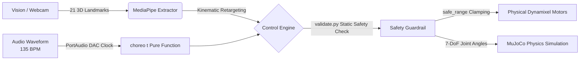

<!-- ========================================== -->
<!-- HERO HEADER                                -->
<!-- ========================================== -->

  <h1 class="nerfies-title">
    로봇손 파지 프로젝트의 확장: 시뮬레이션, 실시간 비전 조작, 오디오 동기화 안무
  </h1>
  

    기본 물체 파지에서 더 나아가, MuJoCo 물리 시뮬레이션부터 실시간 웹캠 원격 제어와 음악 비트 안무까지 구현한 3지 다관절 로봇손(tri_hand) 프로젝트
  

  

    <a href="https://github.com/yeonjunky" target="_blank">Yeonjun Kim</a>1
    <a href="https://github.com/carryplz" target="_blank">Carryplz</a>1
    <a href="https://github.com/erdoslibrary" target="_blank">Erdoslibrary</a>1
  

  

    1Robot Hand Team / ajin-robot-hand Research Group
  

  

    <a href="https://github.com/ajin-robot-hand" class="nerfies-btn" target="_blank">
      <svg width="18" height="18" viewBox="0 0 24 24" fill="currentColor"><path d="M12 0C5.37 0 0 5.37 0 12c0 5.31 3.435 9.795 8.205 11.385.6.105.825-.255.825-.57 0-.285-.015-1.23-.015-2.235-3.015.555-3.795-.735-4.035-1.41-.135-.345-.72-1.41-1.23-1.695-.42-.225-1.02-.78-.015-.795.945-.015 1.62.87 1.845 1.23 1.08 1.815 2.805 1.305 3.495.99.105-.78.42-1.305.765-1.605-2.67-.3-5.46-1.335-5.46-5.925 0-1.305.465-2.385 1.23-3.225-.12-.3-.54-1.53.12-3.18 0 0 1.005-.315 3.3 1.23.96-.27 1.98-.405 3-.405s2.04.135 3 .405c2.295-1.56 3.3-1.23 3.3-1.23.66 1.65.24 2.88.12 3.18.765.84 1.23 1.905 1.23 3.225 0 4.605-2.805 5.625-5.475 5.925.435.375.81 1.095.81 2.22 0 1.605-.015 2.895-.015 3.3 0 .315.225.69.825.57A12.02 12.02 0 0024 12c0-6.63-5.37-12-12-12z"/></svg>
      Code (GitHub)
    </a>
    <a href="#pipeline" class="nerfies-btn secondary">
      <svg width="18" height="18" viewBox="0 0 24 24" fill="currentColor"><path d="M4 6h16v2H4zm0 5h16v2H4zm0 5h16v2H4z"/></svg>
      Pipeline
    </a>
    <a href="#video-gallery" class="nerfies-btn secondary">
      <svg width="18" height="18" viewBox="0 0 24 24" fill="currentColor"><path d="M21 3H3c-1.1 0-2 .9-2 2v14c0 1.1.9 2 2 2h18c1.1 0 2-.9 2-2V5c0-1.1-.9-2-2-2zm-9 9l-4.5 3.5V9.5L12 12zm8 7H4V5h16v14z"/></svg>
      Video Demos
    </a>
    <a href="#results" class="nerfies-btn secondary">
      <svg width="18" height="18" viewBox="0 0 24 24" fill="currentColor"><path d="M19 3H5c-1.1 0-2 .9-2 2v14c0 1.1.9 2 2 2h14c1.1 0 2-.9 2-2V5c0-1.1-.9-2-2-2zm-7 14l-5-5 1.41-1.41L12 14.17l7.59-7.59L21 8l-9 9z"/></svg>
      Benchmarks
    </a>
    <a href="#bibtex" class="nerfies-btn secondary">
      <svg width="18" height="18" viewBox="0 0 24 24" fill="currentColor"><path d="M14 2H6c-1.1 0-1.99.9-1.99 2L4 20c0 1.1.89 2 1.99 2H18c1.1 0 2-.9 2-2V8l-6-6zm2 16H8v-2h8v2zm0-4H8v-2h8v2zm-3-5V3.5L18.5 9H13z"/></svg>
      BibTeX
    </a>
    <a href="2026-10-14-tri-hand-basic.md" class="nerfies-btn secondary">
      ⬅️ Basic Project
    </a>
  

<!-- ========================================== -->
<!-- TEASER MEDIA: HERO DEMO VIDEO              -->
<!-- ========================================== -->

  

    <iframe 
      src="https://www.youtube.com/embed/c8-295kr47s?rel=0&modestbranding=1" 
      title="tri_hand Real-Time Vision Teleoperation Demo" 
      allow="accelerometer; autoplay; clipboard-write; encrypted-media; gyroscope; picture-in-picture; web-share" 
      referrerpolicy="strict-origin-when-cross-origin" 
      allowfullscreen>
    </iframe>
  

  

    <strong>Teaser: Real-Time Vision Teleoperation:</strong> 별도 센서 없이 웹캠만으로 손 움직임을 실시간 인식하여 로봇손을 원격 조작하는 구동 영상입니다.
  

<!-- more -->

<!-- ========================================== -->
<!-- SECTION 1: ABSTRACT & CONTRIBUTIONS        -->
<!-- ========================================== -->

  <h2 class="nerfies-sec-title">Abstract &amp; Key Contributions</h2>
  

    

      본 프로젝트 <code>tri_hand</code>는 기존 <strong>로봇손 파지(Grasping) 연구에서 한 걸음 더 나아가</strong>, 3지 다관절(7-DoF) 로봇손을 활용해 <strong>"시뮬레이션에서 충분히 검증하지 않은 코드는 실물 로봇에 넣지 않는다"</strong>는 원칙을 바탕으로 개발을 확장했습니다.
      가상 시뮬레이션(Digital Twin)부터 실물 하드웨어 배포(Sim-to-Real), 비전 기반 실시간 원격 조작(Teleoperation), 그리고 음악 비트 동기화 제어(Choreography)까지 이어지는 전체 엔지니어링 제어 체계를 단계별로 구축했습니다.
    

    

    <h4 style="margin: 0 0 0.8rem 0; font-size: 1.05rem; color: var(--md-typeset-color, #1e293b);">🌟 핵심 엔지니어링 성과</h4>
    <ul style="margin-bottom: 0; padding-left: 1.2rem;">
      <li><strong>시각 메쉬와 충돌체 분리 설계</strong>: 겉모양을 보여주는 정밀 메쉬와 물리 계산용 단순 충돌체를 따로 설계해, 시뮬레이션 연산이 튀는 현상과 자체 충돌(Self-Collision)을 방지했습니다.</li>
      <li><strong>비대칭 안전 가동 범위(<code>safe_range</code>) 수립</strong>: 손가락을 모을 때와 펼칠 때의 물리적 한계를 각각 측정해 관절 가동 범위를 다르게 잡고, 모터 과열을 방지하는 제어 게인을 맞췄습니다.</li>
      <li><strong>웹캠 기반 7-DoF 원격 조작과 안전 보호(Fail-Safe)</strong>: 특수 장비 없이 일반 웹캠만으로 손가락 마디 움직임을 읽어 로봇손으로 연결하고, 손이 화면을 벗어날 때 급작스럽게 튀지 않도록 안전 필터를 적용했습니다.</li>
      <li><strong>오디오 DAC 클럭 기반 서브밀리초 안무 엔진</strong>: 컴퓨터 사운드 출력 시각을 기준으로 삼아 <strong>0.2ms 이하의 오차</strong>로 음악 박자에 딱 맞춰 움직이는 시간 제어 함수를 구현했습니다.</li>
    </ul>
  

<!-- ========================================== -->
<!-- QUANTITATIVE RESULTS (Stat Badges)         -->
<!-- ========================================== -->

  <h2 class="nerfies-sec-title">Key Quantitative Highlights</h2>
  

    

      
&lt; 0.2 ms

      
Clock Drift Accuracy

      
오디오 재생 시각 기반 동기화 편차 (시간이 지나도 누적 오차 없음)

    

    

      
&le; 3.0 rad/s

      
Max Joint Velocity Guard

      
사전 검증 스크립트(<code>validate.py</code>)로 급격한 가속과 하드웨어 충격 방지

    

    

      
Zero (0)

      
Self-Collision Incidence

      
외형 메쉬와 충돌체 분리 및 비대칭 안전 가동 범위 적용으로 충돌 없음

    

  

<!-- ========================================== -->
<!-- SECTION 2: END-TO-END PIPELINE             -->
<!-- ========================================== -->

  <h2 class="nerfies-sec-title">End-to-End System Pipeline</h2>
  

    

      모든 제어 명령은 사전 안전 검사를 거친 뒤 시뮬레이터와 실물 로봇손으로 안전하게 전달됩니다.
    

    

      

        Phase 1
        
Digital Twin (MuJoCo)

        
정밀 외형 메쉬와 단순 충돌체를 분리 설계해 물리 엔진 안정성을 확보하고, 7개 관절의 회전 기준을 정립했습니다.

      

      

        Phase 2
        
Sim-to-Real Calibration

        
손가락끼리 부딪히지 않는 안전 범위를 정하고, 모터 허용 힘에 맞춰 부드러운 제어값을 찾았습니다.

      

      

        Phase 3
        
Vision Teleoperation

        
웹캠으로 손가락 굽힘 정도를 실시간 계산해 전달하고, 손을 놓쳤을 때 오작동을 막는 보호 로직을 넣었습니다.

      

      

        Phase 4
        
Audio Choreography

        
스피커 소리 출력 지연을 자동으로 보정해 박자를 맞추고, 음악 시작 전 부드럽게 기본 자세를 잡도록 했습니다.

      

    

  

<!-- ========================================== -->
<!-- SECTION 3: PHASE 1 DEEP DIVE               -->
<!-- ========================================== -->

  <h2 class="nerfies-sec-title">Phase 1: Digital Twin &amp; MuJoCo Physics</h2>
  

    

      <h3 style="margin-top: 0; font-size: 1.25rem;">시각 메쉬(Visual)와 충돌체(Collision)의 분리 설계</h3>
      

        복잡한 3D CAD 모델을 물리 시뮬레이터에 그대로 넣으면 계산량이 급격히 늘어날 뿐 아니라, 표면이 맞물리면서 물리 연산이 튀거나 손가락끼리 끼이는 문제가 생깁니다.
      

      <ul>
        <li><strong>외형 렌더링</strong>: 정밀한 STL 메쉬는 화면에 보여주는 용도로만 쓰고, 물리 접촉 계산에서는 제외했습니다.</li>
        <li><strong>물리 연산</strong>: 모델 내부에 상자와 캡슐 같은 단순한 기본 도형으로 충돌 영역을 따로 정의해, 계산 속도와 물리 안정성을 크게 높였습니다.</li>
        <li><strong>관절 회전 방향 통일</strong>: 위쪽 손가락(3관절)과 아래쪽 손가락 2개(각 2관절)의 서로 다른 회전 방향 기준을 하나의 좌표계 규칙으로 맞췄습니다.</li>
      </ul>
    

    

      <pre style="text-align: left; background: transparent; margin: 0; font-size: 0.8rem; color: var(--md-typeset-color, #334155); line-height: 1.45;"><code>&lt;!-- MJCF Dual-Layer Design --&gt;
&lt;!-- 1. Visual Only (No Contact) --&gt;
&lt;geom type="mesh" mesh="finger_vis" 
      group="1" contype="0" conaffinity="0"/&gt;

&lt;!-- 2. Physics Collision Primitive --&gt;
&lt;geom type="capsule" size="0.012 0.025" 
      group="0" contype="1" conaffinity="1"/&gt;</code></pre>
      

        <em>Collision Primitives Encapsulation (MuJoCo)</em>
      

    

  

<!-- ========================================== -->
<!-- SECTION 4: PHASE 2 DEEP DIVE               -->
<!-- ========================================== -->

  <h2 class="nerfies-sec-title">Phase 2: Hardware Bring-Up &amp; Sim-to-Real</h2>
  

    

      

        비대칭 관절 안전 가동 범위 (safe_range)
      

      <table class="nerfies-specs-table" style="margin: 0; font-size: 0.82rem;">
        <thead>
          <tr>
            <th>자세 상태</th>
            <th>j1 (기저)</th>
            <th>j2 (말단)</th>
            <th>기구학적 설계 목적</th>
          </tr>
        </thead>
        <tbody>
          <tr>
            <td><strong>Q_CLOSE</strong></td>
            <td>0.3 rad</td>
            <td>1.2 rad</td>
            <td>손가락 간 맞물림 및 내부 충돌 방지</td>
          </tr>
          <tr>
            <td><strong>Q_OPEN</strong></td>
            <td>1.2 rad</td>
            <td>0.3 rad</td>
            <td>프레임 기계적 하드스톱 간섭 방어</td>
          </tr>
        </tbody>
      </table>
      

        0 rad(곧게 편 자세)을 가동 한계가 아닌 중심 기준점(Neutral)으로 설정
      

    

    

      <h3 style="margin-top: 0; font-size: 1.25rem;">물리적 기구 한계를 반영한 비대칭 가동 범위</h3>
      

        실제 하드웨어인 다이나믹셀 XL430 모터는 시뮬레이션과 달리 동작할 때 열이 발생하고, 기어 유격(백래시)과 기계적 회전 한계가 존재합니다.
      

      <ul>
        <li><strong>비대칭 안전 가동 범위</strong>: 손가락을 쥘 때(<code>Q_CLOSE</code>)는 안쪽 충돌을 막기 위해 첫째 관절(<code>j1</code>)을 0.3 rad까지만 움직이고 끝 관절(<code>j2</code>)을 더 많이 굽히며, 펼칠 때(<code>Q_OPEN</code>)는 몸체에 걸리지 않도록 반대로 움직임을 조절했습니다.</li>
        <li><strong>과열 및 무리한 동작 방지</strong>: 모터가 억지로 버티며 과열되지 않도록 부드러운 제어 게인을 설정해, 장시간 연속으로 동작해도 모터가 멈추지 않도록 했습니다.</li>
      </ul>
    

  

<!-- ========================================== -->
<!-- SECTION 5: PHASE 3 DEEP DIVE (VIDEO EMBED) -->
<!-- ========================================== -->

  <h2 class="nerfies-sec-title">Phase 3: Vision-Based Teleoperation</h2>
  

    

      <h3 style="margin-top: 0; font-size: 1.25rem;">무접촉 인간 손-로봇 기구학 리타겟팅</h3>
      

        비싼 특수 장갑 없이도 노트북 웹캠 하나로 사람 손의 관절 위치를 파악해 7개 모터로 곧바로 연결했습니다.
      

      <ul>
        <li><strong>관절 대응 규칙</strong>:
          <ul>
            <li>인간 검지·중지·약지 ➡️ 로봇 손가락 A·B·C에 1:1 대응</li>
            <li>손허리 관절(MCP) 굽힘 각도 ➡️ 기저 관절(<code>j1</code>)</li>
            <li>손가락 마디 합(PIP + DIP) ➡️ 말단 관절(<code>j2</code>)</li>
            <li>엄지 벌림 각도 ➡️ 대립 회전 관절(<code>A_j0</code>)</li>
          </ul>
        </li>
        <li><strong>안전 보호 로직(Fail-Safe)</strong>: 손이 카메라 화면 밖으로 나가거나 가려져도 로봇이 갑자기 튀지 않도록 직전 자세를 유지하고, 떨림을 줄여주는 이동평균 필터를 적용했습니다.</li>
      </ul>
    

    

      

        <iframe 
          src="https://www.youtube.com/embed/c8-295kr47s?rel=0&modestbranding=1" 
          title="tri_hand Webcam Vision-Based Teleoperation Live Demo" 
          allow="accelerometer; autoplay; clipboard-write; encrypted-media; gyroscope; picture-in-picture; web-share" 
          referrerpolicy="strict-origin-when-cross-origin" 
          allowfullscreen>
        </iframe>
      

      

        📹 <strong>Live Teleoperation:</strong> 웹캠 기반 손동작 인식 및 tri_hand 7-DoF 실시간 원격 조작
      

    

  

<!-- ========================================== -->
<!-- SECTION 6: PHASE 4 DEEP DIVE               -->
<!-- ========================================== -->

  <h2 class="nerfies-sec-title">Phase 4: Music-Synchronized Choreography</h2>
  

    

      

        <iframe 
          src="https://www.youtube.com/embed/2_KnKuTeGbY?rel=0&modestbranding=1" 
          title="tri_hand Music-Synchronized Choreography Sim-to-Real" 
          allow="accelerometer; autoplay; clipboard-write; encrypted-media; gyroscope; picture-in-picture; web-share" 
          referrerpolicy="strict-origin-when-cross-origin" 
          allowfullscreen>
        </iframe>
      

      

        🎵 <strong>Choreography (135 BPM):</strong> PortAudio DAC 클럭 동기화 0.2ms 지연 안무 구동
      

    

    

      <h3 style="margin-top: 0; font-size: 1.25rem;">PortAudio DAC 마스터 클럭 기반 서브밀리초 안무</h3>
      

        카메라 영상 인식은 특성상 미세한 연산 지연과 떨림이 생기기 쉽습니다. 
        음악 박자에 맞춰 오차 없이 움직이도록, 컴퓨터 사운드 카드의 오디오 출력 시각을 기준으로 삼아 동작을 계산하는 제어 파이프라인을 만들었습니다.
      

      <ul>
        <li><strong>누적 오차 없는 시간 함수 <code>choreo(t)</code></strong>: 이전 동작의 오차가 누적되지 않고 현재 음악 시각에 맞춰 관절 위치를 직접 계산하므로, 음악을 오래 재생해도 시간 차이가 벌어지지 않습니다.</li>
        <li><strong>스피커 소리 지연 보정</strong>: 소리가 스피커로 나가는 미세한 시간 지연을 측정해 모터 신호를 미리 전송함으로써 0.2ms 수준의 정확한 타이밍을 맞췄습니다.</li>
        <li><strong>시작 준비 동작(프리롤)</strong>: 음악이 시작될 때 모터가 갑자기 튀지 않도록, 재생 2초 전부터 기본 자세로 천천히 이동하는 준비 구간을 두었습니다.</li>
      </ul>
    

  

<!-- ========================================== -->
<!-- SECTION 7: SAFETY & VALIDATION             -->
<!-- ========================================== -->

  <h2 class="nerfies-sec-title">Safety Guardrails &amp; Static Verifier</h2>
  

    <h3 style="margin-top: 0; font-size: 1.15rem; color: var(--md-typeset-color, #1e293b);">
      실물 구동 전 자동 사전 검증 (<code>validate.py</code>)
    </h3>
    

      동작을 설계할 때 실수하더라도 실제 로봇에 무리한 힘이나 위험한 신호가 전달되지 않도록, 전체 움직임을 사전에 시뮬레이션으로 전수 검사하는 스크립트(<code>validate.py</code>)를 적용했습니다.
    

    

      

        
1. 속도 상한 검사

        
모든 관절 회전 속도가 안전 기준(3.0 rad/s) 이하인지 전 구간 검사

      

      

        
2. 박자 정렬 확인

        
음악 마디와 비트에 맞춰 관절 동작이 제때 일어나는지 검사

      

      

        
3. 사전 충돌 검사

        
화면 없이 빠르게 시뮬레이션을 돌려 손가락 간 충돌이 0건임을 확인

      

    

  

<!-- ========================================== -->
<!-- SECTION 8: VIDEO GALLERY & SHOWCASE        -->
<!-- ========================================== -->

  <h2 class="nerfies-sec-title">Video Showcase Gallery</h2>
  

    실시간 웹캠 조작과 음악 동기화 안무의 실제 구동 영상을 확인해 보세요.
  

  

    <!-- Video Card 1: Teleoperation (First) -->
    

      

        <iframe 
          src="https://www.youtube.com/embed/c8-295kr47s?rel=0&modestbranding=1" 
          title="Webcam Vision Teleoperation Demo" 
          allow="accelerometer; autoplay; clipboard-write; encrypted-media; gyroscope; picture-in-picture; web-share" 
          referrerpolicy="strict-origin-when-cross-origin" 
          allowfullscreen>
        </iframe>
      

      

        <h4>1. Real-Time Vision Teleoperation (7-DoF)</h4>
        

          웹캠으로 사람의 손 움직임을 실시간 추적하여 로봇손으로 제어하고, 손이 가려지거나 화면을 벗어날 때 급발진을 방지하는 Fail-safe 안전 제어를 시연합니다.
        

      

    

    <!-- Video Card 2: Music Choreography -->
    

      

        <iframe 
          src="https://www.youtube.com/embed/2_KnKuTeGbY?rel=0&modestbranding=1" 
          title="Music-Synchronized Choreography Demo" 
          allow="accelerometer; autoplay; clipboard-write; encrypted-media; gyroscope; picture-in-picture; web-share" 
          referrerpolicy="strict-origin-when-cross-origin" 
          allowfullscreen>
        </iframe>
      

      

        <h4>2. Music-Synchronized Choreography (135 BPM)</h4>
        

          오디오 출력 시각을 기준으로 삼아 0.2ms 수준의 정밀한 타이밍으로 음악에 맞춰 안무를 수행하는 시뮬레이션 및 실물 로봇 구동 영상입니다.
        

      

    

  

<!-- ========================================== -->
<!-- SECTION 9: HARDWARE SPECS & RESOURCES      -->
<!-- ========================================== -->

  <h2 class="nerfies-sec-title">Hardware Specs &amp; Resources</h2>
  

    <h3 style="margin-top: 0; font-size: 1.15rem;">tri_hand Hardware Bill of Materials (BOM)</h3>
    <table class="nerfies-specs-table">
      <thead>
        <tr>
          <th>구분</th>
          <th>부품 및 구성</th>
          <th>세부 사양</th>
          <th>담당 역할</th>
        </tr>
      </thead>
      <tbody>
        <tr>
          <td><strong>Actuator</strong></td>
          <td>ROBOTIS Dynamixel XL430-W250-T (×7)</td>
          <td>정격 토크 1.4 N·m, Protocol 2.0</td>
          <td>손가락 A (3관절), 손가락 B (2관절), 손가락 C (2관절) 구동</td>
        </tr>
        <tr>
          <td><strong>Interface</strong></td>
          <td>ROBOTIS U2D2 + Power Hub</td>
          <td>USB to RS485 / TTL, 1 Mbps Baudrate</td>
          <td>PC와 모터 간 고속 제어 신호 통신</td>
        </tr>
        <tr>
          <td><strong>Power</strong></td>
          <td>SMPS DC 12V 5A 전원 공급기</td>
          <td>안정적인 전원 공급</td>
          <td>순간 최대 전류 수용 및 모터 토크 유지</td>
        </tr>
        <tr>
          <td><strong>Kinematics</strong></td>
          <td>3D Printed Modular Frame &amp; Linkage</td>
          <td>PLA+ 고강도 필라멘트 출력</td>
          <td>마주 보는 3개 손가락(Opposable)의 기계 구조 구현</td>
        </tr>
      </tbody>
    </table>

    

      <a href="https://github.com/ajin-robot-hand" class="nerfies-btn" target="_blank">
        <svg width="18" height="18" viewBox="0 0 24 24" fill="currentColor"><path d="M12 0C5.37 0 0 5.37 0 12c0 5.31 3.435 9.795 8.205 11.385.6.105.825-.255.825-.57 0-.285-.015-1.23-.015-2.235-3.015.555-3.795-.735-4.035-1.41-.135-.345-.72-1.41-1.23-1.695-.42-.225-1.02-.78-.015-.795.945-.015 1.62.87 1.845 1.23 1.08 1.815 2.805 1.305 3.495.99.105-.78.42-1.305.765-1.605-2.67-.3-5.46-1.335-5.46-5.925 0-1.305.465-2.385 1.23-3.225-.12-.3-.54-1.53.12-3.18 0 0 1.005-.315 3.3 1.23.96-.27 1.98-.405 3-.405s2.04.135 3 .405c2.295-1.56 3.3-1.23 3.3-1.23.66 1.65.24 2.88.12 3.18.765.84 1.23 1.905 1.23 3.225 0 4.605-2.805 5.625-5.475 5.925.435.375.81 1.095.81 2.22 0 1.605-.015 2.895-.015 3.3 0 .315.225.69.825.57A12.02 12.02 0 0024 12c0-6.63-5.37-12-12-12z"/></svg>
        GitHub 저장소에서 소스코드 및 CAD 모델 보기
      </a>
    

  

<!-- ========================================== -->
<!-- SECTION 10: BIBTEX CITATION                -->
<!-- ========================================== -->

  <h2 class="nerfies-sec-title">BibTeX Citation</h2>
  

    본 연구 및 제어 프레임워크를 인용하거나 활용하실 경우 아래 형식을 참조해 주세요.
  

  <pre class="nerfies-bibtex-block"><code>@misc{trihand2026showcase,
  author    = {Yeonjun Kim and Carryplz and Erdoslibrary},
  title     = {로봇손 파지 프로젝트의 확장: 시뮬레이션, 실시간 비전 조작, 오디오 동기화 안무 (tri_hand)},
  year      = {2026},
  publisher = {GitHub},
  howpublished = {\url{https://github.com/ajin-robot-hand/docs}},
  note      = {End-to-End Robotics Showcase: MuJoCo Simulation, Vision Teleoperation, and Audio Synchronization}
}</code></pre>

